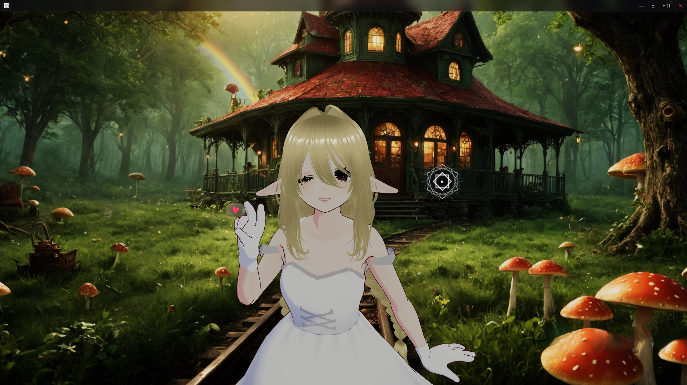
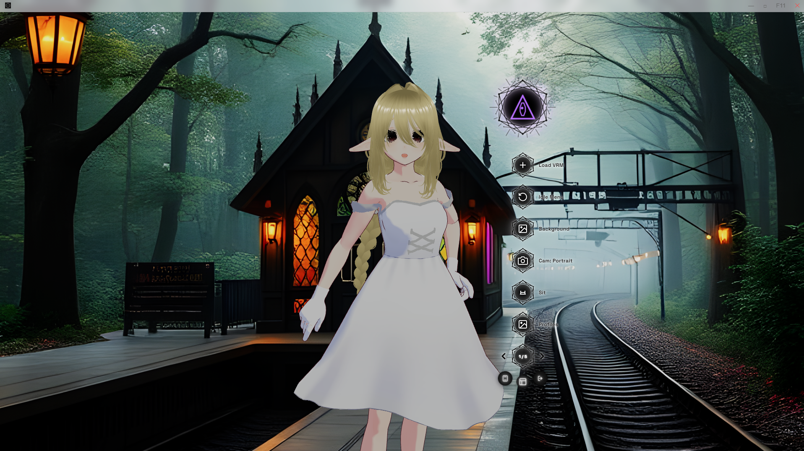
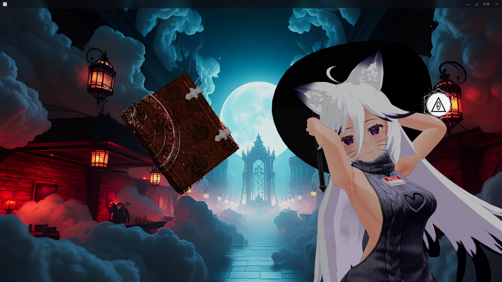

# i+°i — eye to eye

**Windows desktop is the primary evaluation program.** i+°i is David Glowalla's VRM character presentation and desktop overlay application. The name reads “eye to eye” and resembles two people talking. CCU is its internal development name.

## Windows desktop evaluation

Download the current **[Windows desktop alpha 0.1.4 (R6)](https://github.com/Nibiru99/eye-to-eye-evaluation/releases/tag/desktop-alpha-20261011-r6)**, together with its release manifest and SHA-256 checksum. The installer includes the application runtime, six default VRMs, geometric menu artwork and 41 managed animations; Node.js and development tools are unnecessary. Android remains an optional separate preview.

Explore character presentation, VRM loading, animation controls, backgrounds, camera/presentation modes and profiles. Use [DESKTOP-TESTING.md](DESKTOP-TESTING.md) to record what works on your PC and report remaining alpha bugs. Feature availability and behavior depend on the build, supplied assets and hardware.

The application is named **i+°i — eye to eye**. Setup offers folder selection and defaults fresh installation to **Program Files (x86)\i+°i**, with the official application/installer icons, desktop shortcut and an uninstaller in the installation folder. Windows administrator approval is required to install there. Existing profiles are retained. This is an unsigned evaluation alpha.

The author successfully tested R6 installation and startup on the development PC; the installed application archive matches the tested package. Bundled model/graphic checks and managed-animation integrity checks passed. This does not establish exhaustive feature or hardware compatibility testing. Earlier desktop packages remain historical snapshots; R2 has a known installation issue and is superseded by R6.

## Explore the desktop program

- **Layered character presentation:** automatic camera movement and parallax backgrounds combine for a holographic-style visual effect. Transparent overlay, portrait/fullscreen and POV modes support different presentation setups.
- **Single or dual VRM:** bundled female/male presets, custom VRM slots, two-character presentation and camera/eye-contact/organic gaze modes. Organic gaze follows speaking/listening state; optional audio input drives lip sync and talking reactions.
- **Responsive character behavior:** blinking, breathing and expression controls, click/triple-click wink reactions, and managed standing, talking, sitting, reaction, spawn and idle/action animation categories.
- **Customizable presentation:** background images and MP4 video textures, including 4K MP4 evaluation where codec/GPU performance permits. Profiles have thumbnails and save presentation settings; VRM and idle customization menus support personal setups and profile import/export.
- **Experimental viewing modes:** Ocular VR stereo alpha, AR camera test and controller/gamepad interactions. These are alpha features with device-specific requirements, not certified headset/AR compatibility.

The corrected desktop package includes six default VRMs, the geometric orb/menu artwork, official logos and the owner-confirmed main animation library. Original component and asset terms remain applicable. The gallery below shows author-selected historical examples.

## Examples

Historical desktop example, June 14, 2026: character and presentation controls.

Historical desktop example, May 28, 2026: another character and an author-generated background. The opening image is from July 21, 2026. These illustrate presentation possibilities; they are not a current-build acceptance test or a promise that pictured models/backgrounds are included. Example artwork and models retain their applicable rights.

## Optional Android preview

The [August 30 Android APK](https://github.com/Nibiru99/eye-to-eye-evaluation/releases/tag/mobile-alpha-20260830) is an **optional mobile alpha/demo**. It is a separate preview and does not replace the Windows desktop evaluation. See [TESTING.md](TESTING.md) for the mobile instructions. It retains the internal CCU Overlay label, is debug-signed and has remaining bugs.

## Company evaluation and customization

Individuals and organizations may evaluate designated binaries for **30 calendar days from first installation**, under [LICENSE-EVAL.md](LICENSE-EVAL.md). The time limit is contractual; the existing binaries have no automatic timed lock.

Companies can discuss platform integration, colors, presentation design, function changes and production licensing with David Glowalla. Production/OEM use, redistribution, source access and modification require a separate written agreement. The pre-existing application remains his property; separately licensed components retain their terms.

Report reproducible bugs and refinement requests through [Issues](https://github.com/Nibiru99/eye-to-eye-evaluation/issues), including build/hash, Windows version, GPU and steps. Keep confidential platform information out of public issues. A request does not itself commission work or grant deployment rights.

This repository distributes evaluation binaries, documentation and examples. Development source remains private. Packaging does not guarantee protection against reverse engineering.
